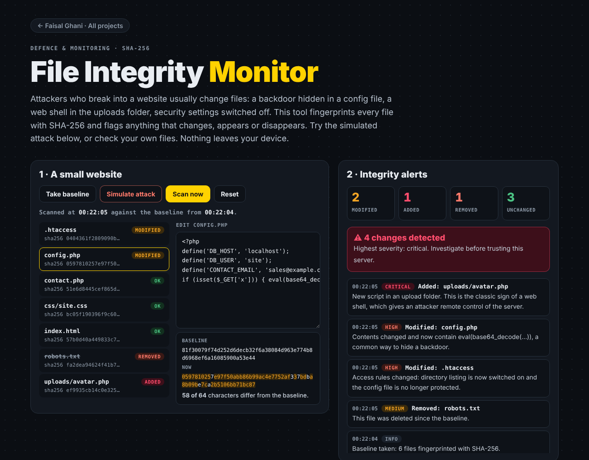

# File Integrity Monitor

[](https://github.com/FaisalGhani786/file-integrity/actions/workflows/test.yml)

**Detect tampered, added and deleted files with SHA-256 fingerprints.** A browser demo you can try in seconds, plus a Python command-line tool for real servers. Both use the same baseline format.

**Live demo:** https://faisalghani786.github.io/file-integrity/



## Why it matters

When attackers break into a website they usually change files: a backdoor hidden in a config file, a web shell dropped in the uploads folder, security settings switched off. File integrity monitoring catches this by fingerprinting every file while it's known to be clean, then flagging anything that differs. It's a standard control in tools like Tripwire, AIDE and Wazuh, and the PCI DSS card-payment standard requires change detection on critical files.

## Browser demo

- **Simulated attack** on a small website: a backdoor is injected into `config.php`, a web shell appears in `uploads/`, `.htaccess` protection is removed and `robots.txt` is deleted. A scan flags all four with timestamps and severities.
- **Edit any file** and see the avalanche effect: one changed character alters most of the 64-character hash.
- **Check your own files:** create a baseline from a folder, download it, and check the folder against it later. Hashing happens in the browser with the Web Crypto API; nothing is uploaded.

## Python CLI

```bash
pip install -r python/requirements.txt         # only needed for watch mode

python python/fim.py baseline /var/www/site -o baseline.json
python python/fim.py check /var/www/site -m baseline.json    # exit code 1 if anything changed
python python/fim.py check /var/www/site -m baseline.json --json
python python/fim.py watch /var/www/site -m baseline.json    # live alerts
```

Example output:

```
SEVERITY   CHANGE    PATH
CRITICAL   ADDED     uploads/avatar.php
HIGH       MODIFIED  .htaccess
HIGH       MODIFIED  config.php
MEDIUM     REMOVED   robots.txt

4 change(s), 3 unchanged.
```

The non-zero exit code means `check` can run from cron or a CI job and alert when it fails.

## Severity rules

| Severity | Rule |
|---|---|
| Critical | New script (`.php`, `.sh`, `.aspx`…) in an upload, media, tmp or cache folder |
| High | Any change to config or access files (`.htaccess`, `.env`, `wp-config.php`, `authorized_keys`…), or a new script anywhere |
| Medium | Deleted `robots.txt` / `.htaccess` / `security.txt`, or a changed script |
| Low | Any other change |

## Baseline format

Shared by both tools, so a baseline from one can be checked by the other:

```json
{
  "tool": "file-integrity",
  "version": 1,
  "algorithm": "sha256",
  "created": "2026-10-31T00:00:00+00:00",
  "root": "site",
  "files": {
    "config.php": { "sha256": "81f30079…", "size": 111 }
  }
}
```

Only hashes and sizes are stored, never file contents. Timestamps aren't compared, because attackers can reset them with `touch`.

## Tests

```bash
npm test     # 9 JavaScript tests + 6 Python tests
```

A shared fixture proves both implementations agree: the Python tool builds a baseline of `test/fixtures/sample-site`, and the JavaScript tests re-hash the same files and must match it exactly. Every push runs both suites with GitHub Actions and only deploys the site if they pass.

## Built with

JavaScript (ES modules, Web Crypto API), Python 3 (`hashlib`, `argparse`, `watchdog`), Node test runner, `unittest`, GitHub Actions, GitHub Pages.

---

Built by [Faisal Ghani](https://faisalghani786.github.io) for [CyberPro Solutions](https://www.cyberprosolutions.co.uk/) · [LinkedIn](https://www.linkedin.com/in/fa1salg/)
